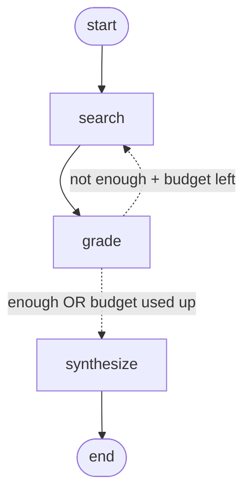

# LangGraph Web Research Agent (with a conditional search loop)

You give it a topic. It searches the web with Tavily, **checks whether the results are good enough**, searches again with a better query if they aren't, and then has GPT-4o-mini write a report with three parts: Summary, Key Findings and Sources.

Based on [01-web-research-agent](https://github.com/ashishpatel26/500-AI-Agents-Projects/tree/main/agents/01-web-research-agent) from *500-AI-Agents-Projects* (MIT). The original is a fixed two-step pipeline (search → synthesize). This version adds:
- a **grade** node, where an LLM judges the results and returns structured output
- a **conditional edge** that loops back to search with a refined query
- a **search budget** (`--max-searches`) so the loop always stops
- results that **accumulate across searches**, deduplicated by URL
- a **mock mode** that runs offline, with no keys and no cost
- tests


Solid arrows are normal edges and always run. Dotted arrows are the conditional edge, where only one of them runs.

---

## Run it

```bash
pip install -r requirements.txt

# 1) Offline, with no keys (mock mode). You can watch the loop happen.
python agent.py

# 2) Real mode
cp .env.example .env          # add OPENAI_API_KEY and TAVILY_API_KEY
python agent.py --query "latest advances in quantum computing"
python agent.py --query "..." --max-searches 2

# See the graph LangGraph built (Mermaid text)
python agent.py --show-graph

# Tests (offline)
python test_agent.py          # or: pytest
```
Mock mode switches on automatically when either key is missing. Set `MOCK_LLM=1` to force it on.

Sample mock run:
```
  [search #1] 'latest advances in AI agents' -> 3 results
  [grade]  sufficient=False - Results are generic; no concrete examples or recent dates.
  [route]  not enough yet -> searching again with 'latest advances in AI agents concrete examples 2026'
  [search #2] 'latest advances in AI agents concrete examples 2026' -> 3 results
  [grade]  sufficient=True - Results now include specific, recent examples.
RESEARCH REPORT  (searches: 2, ...)
```

---

## Concepts (reference notes)

### 1. AI agent
A plain LLM only knows what it learned in training. An **agent** is an LLM plus **tools** (search, APIs, code) plus **control flow** that decides what happens next.
*Example:* ChatGPT may not know "AI news this week". Give it a search tool and it can look it up.

### 2. Tool use
A **tool** is a function the agent calls to reach the outside world. Here the tool is **Tavily web search**.

### 3. RAG (Retrieval-Augmented Generation)
| Step | Meaning | In this project |
|---|---|---|
| Retrieve | get relevant text | `tavily_search()` |
| Augment | paste it into the prompt | `format_results()` → `HumanMessage` |
| Generate | the LLM answers **grounded** in that text, so it hallucinates less | `get_llm().invoke(...)` |

This is "web RAG". Classic RAG retrieves from a vector database, but the idea is the same.

### 4. Graph-based workflow (LangGraph)
- **Node** = one step (a Python function)
- **Edge** = an arrow that says "after this, go there"
- **State** = a shared dictionary every node reads and writes

### 5. State
A **shared notebook** passed from node to node. Each node returns **only the keys it changed**, and LangGraph merges them in.

| Key | Written by | Example |
|---|---|---|
| `query` | user | "quantum computing" |
| `current_query` | user, then grade | "quantum computing error correction 2026" |
| `search_results` | search (appended) | `[{url, title, content}, ...]` |
| `search_count` / `max_searches` | search / user | `2` / `3` |
| `is_sufficient`, `grade_reason` | grade | `False`, "no recent sources" |
| `report` | synthesize | "## Summary ..." |

### 6. Reducers (`add_messages`, `operator.add`)
By default, a returned value **overwrites** the old one. A **reducer** changes that rule for one key.
- `Annotated[list, add_messages]` appends chat messages
- `Annotated[list, operator.add]` appends any list (`old + new`)

*Example:* state has `search_results = [A, B]` and the second search returns `[C]`.
Without a reducer you get `[C]`, and the first search is lost. With `operator.add` you get `[A, B, C]`.
**That's why the loop works:** each new search adds to what we already have instead of replacing it.

### 7. Message roles
`SystemMessage` sets the role and rules. `HumanMessage` carries the input. `AIMessage` is the model's reply.

### 8. Temperature
`temperature=0` makes the output as deterministic as possible. Use it for factual work and grading.

### 9. API keys in `.env`
`load_dotenv()` reads `.env` into environment variables, so secrets never go into code or Git. `.env` is in `.gitignore`, and `.env.example` is the template.

### 10. Conditional edge ⭐ (new in this version)
A normal edge always goes to the same place:
```python
graph.add_edge("search", "grade")          # search → grade, every time
```
A **conditional edge** runs a small **router function** after a node. The router reads the state and **returns the name of the next node**:
```python
graph.add_conditional_edges(
    "grade",                                            # 1. after this node finishes...
    route_after_grade,                                  # 2. ...call this function...
    {"search": "search", "synthesize": "synthesize"},   # 3. ...and map its answer to a node
)

def route_after_grade(state) -> str:
    if state["is_sufficient"]:
        return "synthesize"                             # good enough → write the report
    if state["search_count"] >= state["max_searches"]:
        return "synthesize"                             # out of budget → write with what we have
    return "search"                                     # otherwise → loop back and search again
```
Rules to remember:
- The **node does the work** (calls the LLM, updates state). The **router only decides** where to go next: it reads state, doesn't change it, and should be cheap.
- The path map (dict) lists **every possible destination**. LangGraph uses it to validate and draw the graph.
- An edge that points **backwards** (grade → search) is what makes a **loop/cycle**. A plain pipeline can't loop. That's the difference between a *workflow* and an *agent*.

*Example walk-through* (`max_searches=3`):

| Step | Node | State after | Router says |
|---|---|---|---|
| 1 | search | count=1, 5 results | – |
| 2 | grade | sufficient=False, current_query="… 2026" | count 1 < 3 → **search** |
| 3 | search | count=2, 10 results (appended) | – |
| 4 | grade | sufficient=True | **synthesize** |
| 5 | synthesize | report written | → END |

### 11. Loop guard (budget)
Every loop needs a way to stop. Without `max_searches`, a strict grader could loop forever and keep spending money. LangGraph also has a safety net called `recursion_limit` (older versions defaulted to 25 steps; LangGraph 1.x defaults to 10,000; you can set it with `agent.invoke(state, {"recursion_limit": 20})`). Even so, **your own budget is the real design control**: it stops on purpose and still produces a report, while hitting the recursion limit just raises an error.

### 12. Structured output
```python
grader = get_llm().with_structured_output(Grade)   # Grade is a Pydantic model
grade = grader.invoke(messages)                    # returns Grade(is_sufficient=..., reason=..., refined_query=...)
```
The LLM's answer is forced into typed fields. Without this you'd have to parse free text like "I think it's mostly sufficient..." and hope you got it right. Routing code needs a **real `bool`**, not prose.

### 13. LLM-as-a-judge / self-correction (Corrective RAG)
The grade node is an LLM **judging** the retrieval and **rewriting the query** when it's weak. This "retrieve → grade → re-retrieve" pattern is called **Corrective RAG (CRAG)**. It's a simple form of **reflection**.

### 14. Query rewriting
The grader writes `refined_query` to fill the biggest gap, and we pass `queries_tried` so it doesn't repeat itself. *Example:* "AI agents" → "AI agent frameworks production case studies 2026".

### 15. Deduplication
Two searches often return the same page. `unique_results()` keeps the first copy of each URL, so the LLM doesn't read duplicates and you don't pay for them twice.

### 16. Graceful degradation
If the budget runs out before the grader is satisfied, we still write a report, but we tell the LLM the results were judged incomplete so it says what it couldn't confirm. Partial and honest beats crashing or bluffing.

### 17. Mock mode
Fake search and fake LLM functions return the **same shapes** as the real APIs, and the mock grader says "no" the first time so you can see the loop. You can learn, demo and test with no keys and no cost.

---

## Libraries

| Library | Purpose | Used as |
|---|---|---|
| **langgraph** | Graph workflow, state, conditional edges, loops | `StateGraph`, `START`, `END`, `add_conditional_edges`, `add_messages` |
| **langchain-core** | Shared message types | `SystemMessage`, `HumanMessage`, `AIMessage` |
| **langchain-openai** | OpenAI chat model wrapper | `ChatOpenAI(model="gpt-4o-mini", temperature=0)` |
| **langchain-tavily** | Search API made for LLMs; returns clean text, not HTML | `TavilySearch(max_results=5)` |
| **pydantic** | Typed schema for structured output | `class Grade(BaseModel)` |
| **python-dotenv** | Load `.env` into environment variables | `load_dotenv()` |
| `operator`, `typing`, `argparse` (built-in) | List reducer, type hints, CLI flags | `operator.add`, `TypedDict`, `--query` |

---

## Code map (`agent.py`)

| Part | What it does |
|---|---|
| `ResearchState` | The shared state; `search_results` and `queries_tried` use `operator.add` so they accumulate |
| `Grade` | Pydantic schema the grader must fill in |
| `search_web` | Runs Tavily (or mock) on `current_query`, appends results, increments `search_count` |
| `grade_results` | LLM judge returns `Grade`; on "not enough" it sets `current_query` to the refined query |
| `route_after_grade` | **The conditional edge's router**: returns `"search"` or `"synthesize"` |
| `synthesize_report` | Dedupes results, writes the report, and adds a caveat if results were incomplete |
| `build_graph` | Wires START → search → grade ⇢ (search / synthesize) → END |

## Original vs this version

| | Original | This version |
|---|---|---|
| Flow | search → synthesize | search → grade ⇢ search… → synthesize |
| Who decides the path | hard-coded | the LLM's verdict + a budget |
| Searches | always 1 | 1 to `max_searches` |
| Results across searches | n/a | appended + deduplicated |
| Runs without keys | no | yes (mock mode) |

## Ideas to extend
- Skip the grader call on the last allowed search (it can't change the outcome), which saves one LLM call.
- Run 2–3 different queries **in parallel** (fan-out) instead of one at a time.
- Add a **checkpointer** (`MemorySaver`) so you can ask follow-up questions on the same research thread.
- Add a **human-in-the-loop** `interrupt` before synthesize to approve the sources.
- Add a citation checker that verifies every Key Finding comes from a listed source.

## Interview line
> "It's a LangGraph corrective-RAG agent. A search node calls Tavily and appends results to a typed state through an `operator.add` reducer. A grade node uses an LLM with structured output, a Pydantic `Grade` model, to decide whether the results are sufficient and to rewrite the query if they aren't. A conditional edge with a router function then either loops back to search or moves on to synthesize, and a `max_searches` budget guarantees it terminates. The nodes do the work, the router only reads state and picks the next node, and the back-edge is what turns a fixed pipeline into an agent."
